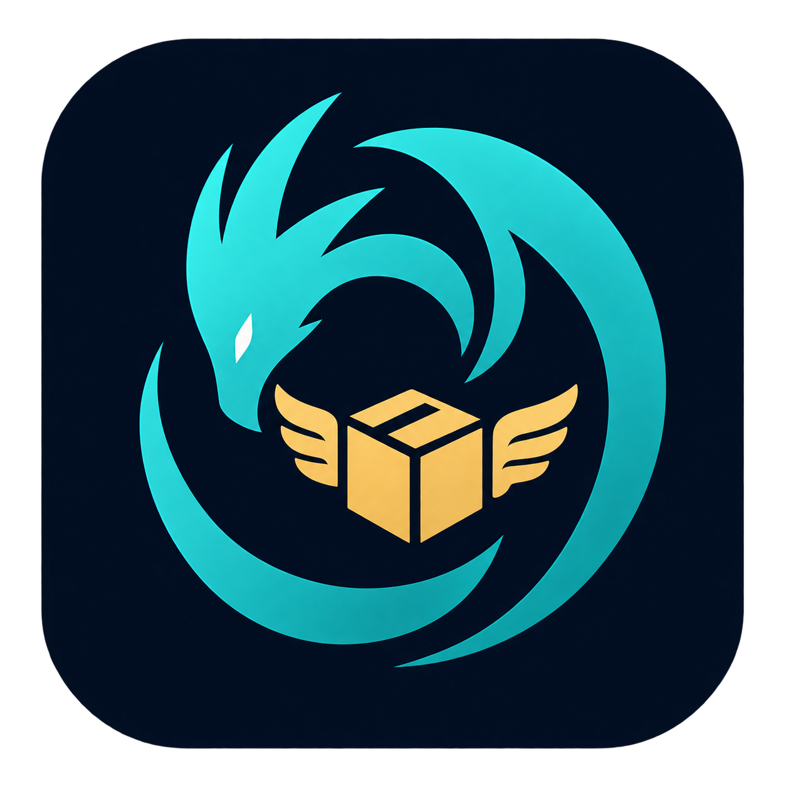

# Hermes's Hoard

Vigilancia de productos, avisos de compra, seguimiento de envíos y planificación de viajes en un único proceso local.

[English](README.md) · [Inventario completo de herramientas](provenance/CAPABILITIES.md) · [Procedencia del código](provenance/sources.json)

## Qué es

Hermes's Hoard sigue lo que quieres comprar, lo que has comprado y adónde vas. Vigila tiendas en busca de reposiciones, bajadas de precio y reservas, lee tu correo para encontrar avisos de envío y de reservas, sigue los paquetes hasta tu puerta y guarda los viajes con sus reservas y gastos compartidos. Funciona en tu propio ordenador, guarda sus datos en archivos locales y te avisa por los canales que elijas.

Incorpora el vigilante de productos y el seguimiento de envíos, con todas sus herramientas, interfaces e historiales nativos, como dos módulos independientes.

## Módulos independientes

Ambos módulos están **apagados en el primer arranque**. Abrir Hermes o descubrir su catálogo MCP no inicia ningún planificador, navegador, lectura de correo ni modelo. Activa solo el módulo que quieras; la elección se conserva. Desactivar un módulo detiene su planificador y espera a que acabe su trabajo actual antes de cerrar la base de datos. El panel sigue disponible durante el apagado.

| Módulo | Qué cubre |
| --- | --- |
| Productos y ofertas | Stock, precios, reservas, lanzamientos, descubrimiento, búsqueda y puntuación de segunda mano, vigilancia de webs y noticias, ofertas del correo, radar de agregadores, vías de descarga con navegador, avisos, programaciones e historial |
| Envíos y viajes | Lectura e importación del correo, números de seguimiento, transportistas, seguimiento y estimaciones de entrega, panel de entregas, incidencias, avisos, viajes y tramos, recordatorios de facturación y salida, correo de viajes, presupuestos y ayudas de moneda y hora |

Las interfaces nativas están en `/products/` y `/shipments/`. Comparten el tema Hoard, el icono de Hermes y el copiloto de Faustus.

## Qué hace

**Productos: vigilancia de tiendas**
- Vigilantes sobre páginas de producto y búsquedas de tiendas para reposición, cambios y umbrales de precio, reservas y lanzamientos, y productos nuevos; una puntuación de confianza, la revalidación y una política antirrevendedores deciden qué merece un aviso.
- Una escalera de formas de leer una página: petición simple, datos estructurados (JSON-LD), navegador sin ventana y **Mi ventana abierta** (Brave, Chrome o Edge en este ordenador, leído con Windows UI Automation sin traerlo al frente). Cada fila de producto de una lista se sigue por separado, y una página que exige comprobación humana genera un aviso de alta prioridad en lugar de responder a la comprobación.
- Las lecturas de ventanas abiertas se contrastan con un modelo y, si Faustus está en marcha, con Faustus leyendo la misma pestaña; Faustus nunca pulsa un botón de compra.
- Un radar de agregadores para stock de cartas y comercio por cadena, leído cada pocos minutos, con calendarios de lanzamientos y stock de tiendas por cadena.
- Avisos de stock leídos del correo de las tiendas en el buzón conectado (solo lectura) y asociados a tus productos vigilados.
- El aviso de una oferta termina con la oferta: cuando una tienda vuelve a agotar, el aviso sale de Novedades, el Historial lo conserva como agotado y se envía como mucho un breve seguimiento de «agotado».
- **Cesta**: una extensión del navegador (`browser/cart-runner`) mantiene abierta una página de producto, añade una unidad cuando el botón de compra se activa y recorre el pago hasta el botón de pagar, donde se detiene; nunca paga. Tiendas admitidas: El Corte Inglés (páginas de producto) y Carrefour (tus listas).
- Búsqueda de segunda mano (Wallapop, Facebook Marketplace y otros) con puntuación de anuncios, estados de guardado y desaparecido, y un radar de libros gratuitos.
- Centinela de información: diferencias de página, vigilancia de canales y búsquedas web que encuentran direcciones nuevas.
- Ofertas del correo: coincidencia con tu lista de deseos, ofertas de tiendas de juegos y de libros, e informe de ruido del buzón.
- Vigilantes de ideas de regalo pedidos por la app de personas, cotejo de compras y presupuesto mostrado en los avisos.
- Marcar un vigilante como comprado (con una referencia local opcional) para dejar de comprobarlo.

**Envíos**
- Paquetes a partir del correo de envío, de números de seguimiento detectados en el texto o añadidos a mano; entre los transportistas están UPS, Correos, DHL y pedidos de Amazon, con 17track como fuente.
- **Consultar un número** hace una consulta puntual al transportista sin guardar un envío.
- **Acción necesaria** lista, por encima de todo, los paquetes que no avanzarán hasta que actúes: aduanas por pagar, documentos de aduanas, una dirección por corregir, una entrega fallida y paquetes esperando en un punto de recogida. No se paga ni se responde nada por ti.
- Estimaciones de entrega que tienen en cuenta la aduana, explicación de cada estimación, historial y estadísticas de entregas, e incidencias.
- Vista previa del calendario de entregas y descarga ICS de las fechas estimadas y de los plazos de recogida (una instantánea, no una suscripción en vivo).
- Fusionar dos registros del mismo paquete; las compras entregadas pueden crear plazos de garantía en la app de papeleo.

**Viajes**
- Viajes con tramos (vuelos, trenes, hoteles, transporte) importados del correo de reservas o añadidos a mano, con notas de puerta, vagón, asiento y clase.
- Recordatorios de facturación y salida, comprobación de caducidad de documentos, exportación al calendario y presupuesto con ayudas de moneda.
- Gastos con personas, pagadores y repartos, renombrar a una persona, fusionar dos viajes o separar reservas seleccionadas en un viaje nuevo. Los gastos pueden pasarse al libro de cuentas.

**Avisos**
- Aviso de Windows, ntfy, Telegram y correo, o el servicio de avisos del hub de la familia. Todo el correo saliente de Hermes lleva el prefijo `[Hermes]` en el asunto y cabeceras `X-Hermes`, y las cuentas de Gmail reciben además la etiqueta **Hermes** (búsqueda `label:hermes`).
- Los resúmenes nocturnos y los avisos del Hub y de Faustus usan los mismos canales.

## Cómo se ejecuta

Python 3.11+. Los avisos de Windows y las integraciones con el navegador de escritorio requieren Windows.

```powershell
python -m venv .venv
.venv\Scripts\python.exe -m pip install -r requirements.txt
.venv\Scripts\python.exe -m hermes_hoard --no-browser
```

Abre `http://127.0.0.1:5221`. `Start.cmd` crea el entorno si no existe; no se abre ninguna ventana automáticamente. El Hoard Hub descubre `faustus-plugin.json` y lanza Hermes de forma explícita. La vía de lectura con navegador necesita el navegador de Playwright: `python -m playwright install chromium`.

| Variable | Para qué sirve |
| --- | --- |
| `HERMES_DATA_DIR`, `HERMES_PORT` / `--port` | Carpeta de datos central y puerto. |
| `HERMES_URL`, `HERMES_TOKEN_FILE` | Ajustes del puente por stdio. |

Sin datos previos, los datos nuevos van a `data/products` y `data/shipments`. Para reutilizar los datos del vigilante y del seguimiento originales, con ambos módulos apagados ejecuta `scripts\adopt_data.py --parent "C:\ruta\a\Hoards"`: solo se escribe el mapa `data/modules.json` y las bases de datos originales, las marcas de correo, las cachés, los perfiles de navegador y los ajustes se quedan donde están. Los datos de un módulo también pueden reubicarse en `data/native/<módulo>/data`, moviendo árboles completos (SQLite WAL/SHM, medios, modelos, sesiones de navegador).

Hermes también puede ejecutarse en una DGX Spark con el PC apagado; el Hoard Hub lo mueve allí y de vuelta (**Ejecutar en**). Fuera de Windows los objetivos de ventana abierta se pausan en silencio y todo lo demás sigue funcionando; mientras corre en la Spark, la copia del PC se niega a arrancar, de modo que un aviso nunca se envía dos veces.

## Conexión con Faustus y la familia Hoard

- **MCP**: `GET /api/agent/tools` lista las herramientas y `POST /api/agent/call` usa el token central de `data/mcp-token`. `mcp_server.py` es el puente por stdio; el descubrimiento funciona con el servidor parado y nunca lo lanza. El catálogo combinado tiene 118 herramientas: las funciones nativas de ambos módulos más `hermes_modules` y `hermes_set_module`. Las llamadas a un módulo apagado responden `module_disabled` sin arrancarlo. Todas las herramientas están en [`provenance/CAPABILITIES.md`](provenance/CAPABILITIES.md).
- **Grupos de herramientas**: vigilantes y objetivos (`watcher_*`, `target_*`, `cart_*`), eventos y anuncios (`events_*`, `listing_*`), radar y ofertas del correo, envíos (`shipment_*`, `track_number`, `shipments_ics`, `phileas_overview`) y viajes (`trip_*`, `segment_*`). Los nombres que existían en ambos catálogos originales (`settings_set`, `secret_set`, `scheduler_status`, `notify_status`, `notify_test`, `telegram_find_chat_id`, `runs_list`) llevan el prefijo `products_` o `shipments_`.
- **Módulos**: `GET /api/modules`, `PUT /api/modules/{id}` con `{"enabled": true|false}` y `POST /api/modules/stop-all`.
- **Hub**: avisos, pasarela de correo (el correo de envíos y reservas se lee una vez para toda la familia), agenda familiar y entradas de compatibilidad para las identidades retiradas, de modo que los tokens, intereses de correo y llamadas entre apps existentes siguen funcionando.
- **Copiloto**: ambas interfaces llevan el panel flotante de Faustus. Las peticiones al modelo de texto usan el servicio de modelo global configurado en la familia; los modelos nunca se cargan con los módulos apagados.
- **Skills**: `hoard-daily-digest`, `hoard-what-happened`, `web-to-clean-markdown` y `unattended-brief` se ofrecen a los agentes que se conectan.

## Estructura del proyecto

| Ruta | Contenido |
| --- | --- |
| `hermes_hoard/` | Servidor combinado, ciclo de vida de los módulos, catálogo de herramientas y envoltorio web |
| `tantalus_hoard/`, `phileas_hoard/` | Motores nativos de productos y envíos |
| `ui/` | Los dos proyectos de interfaz nativa (`npm ci && npm run build` en cada uno; los recursos compilados están incluidos) |
| `browser/cart-runner/` | Extensión de la cesta |
| `compatibility/` | Manifiestos que conservan las identidades retiradas |
| `provenance/` | Inventario de herramientas y procedencia del código (las fuentes Cinzel y Source Sans 3 incluidas llevan sus licencias SIL Open Font) |
| `scripts/` | Adopción de datos, generador del catálogo, servidor de pruebas sin red, verificación MCP |
| `tests/`, `legacy_tests/` | Suites de pruebas |

```powershell
python -m pytest tests -q        # necesita pytest y pytest-asyncio
scripts\qa_server.py             # datos sintéticos, sin red
```

Licencia: MIT (véase `LICENSE`).
