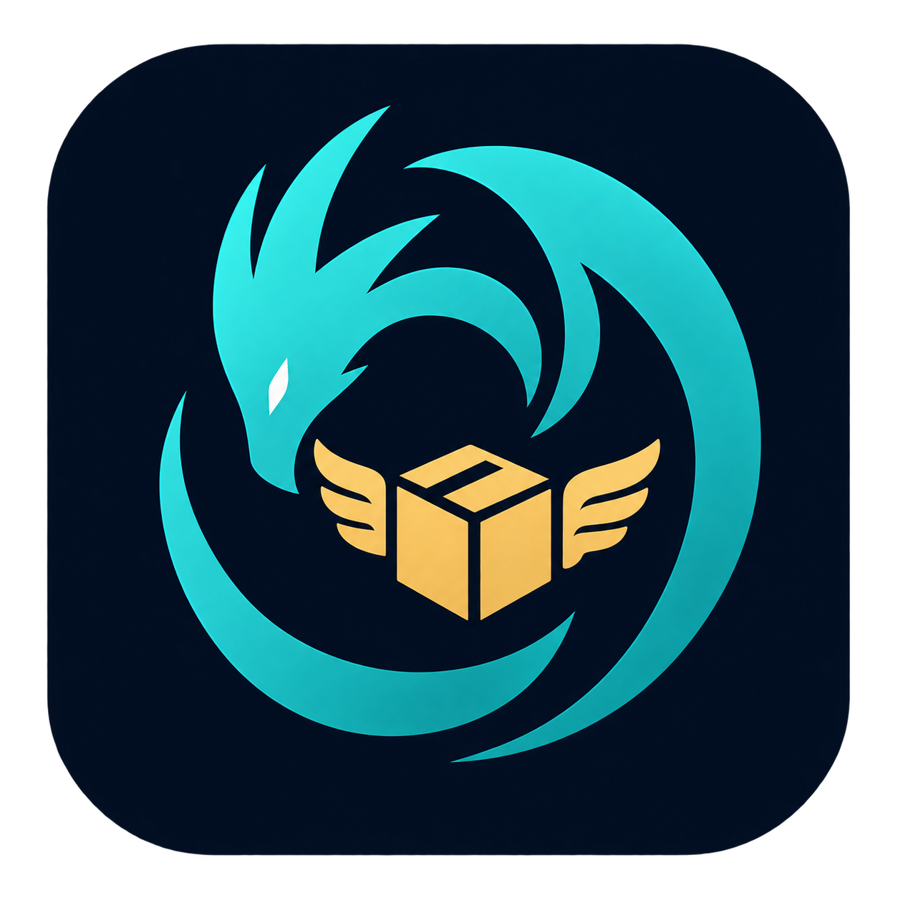

# Hermes's Hoard

Product watching, shopping alerts, shipment tracking and trip planning in one local process.

[Castellano](README.es.md) · [Complete tool inventory](provenance/CAPABILITIES.md) · [Source provenance](provenance/sources.json)

## What it is

Hermes's Hoard follows what you want to buy, what you have bought and where you are going. It watches shops for restocks, price drops and pre-orders, reads your mail for shipping and booking notices, tracks parcels to your door and keeps trips with their bookings and shared expenses. It runs on your own computer, keeps its data in local files and tells you through the channels you choose.

It incorporates the product watcher and the shipment tracker with their complete native tools, interfaces and stored histories, as two independent modules.

## Independent modules

Both modules are **off on first start**. Opening Hermes or discovering its MCP catalogue starts no scheduler, browser, mail scan or model. Enable only the module you want; the choice persists. Disabling a module stops its scheduler and waits for its current work before closing the database. The dashboard remains available during shutdown.

| Module | What it covers |
| --- | --- |
| Products and deals | Stock, prices, pre-orders, releases, discovery, second-hand search and scoring, web and news watches, mail deals, aggregator radar, browser fetch lanes, notifications, schedules and history |
| Shipments and travel | Mail parsing and import, tracking numbers, carriers, tracking and delivery estimates, delivery dashboard, incidents, notifications, trips and segments, check-in and departure reminders, travel mail, budgets and currency and time helpers |

The native interfaces are under `/products/` and `/shipments/`. They share the Hoard theme, the Hermes icon and the Faustus copilot.

## What it does

**Products: watching shops**
- Watchers on product pages and shop searches for restock, price changes and thresholds, pre-orders and releases, new products; a confidence score, revalidation, and an anti-scalper policy decide what is worth an alert.
- A ladder of ways to fetch a page: plain request, structured data (JSON-LD), a headless browser, and **My open window** (Brave, Chrome or Edge on this computer, read through Windows UI Automation without bringing it to the front). Each product row of a list is followed on its own, and a page that needs a human check produces one high-priority notice instead of an answer to the check.
- Readings from open windows are cross-checked by a model and, when Faustus is running, by Faustus reading the same tab; Faustus never clicks a buy button.
- An aggregator radar for trading-card and retail stock by chain, read every few minutes, with release calendars and shop stock by chain.
- Stock notices read from shop mail in the connected mailbox (read-only), matched to your watched products.
- An offer's alert ends with the offer: when a shop sells out again the alert leaves News, History keeps it as sold out, and a short "sold out" follow-up goes out at most once.
- **Basket**: a browser extension (`browser/cart-runner`) keeps a product page open, adds one unit when the buy button comes alive and walks the checkout up to the pay button, where it stops; it never pays. Supported shops are El Corte Ingles (product pages) and Carrefour (your lists).
- **Buying alerts for someone else**: restocks, pre-orders, sales opening and basket stages can also be mailed to extra addresses (Settings → e-mail → "Also mail buying alerts to", `notify.email.buy_also`), from the same account and in a mail of their own; other alerts stay with the owner.
- Second-hand search (Wallapop, Facebook Marketplace and others) with listing scoring, saved and gone states, and a free-books radar.
- Information sentry: page diffs, feed watches and web searches that find new URLs.
- Mail deals: wishlist matching, game-store and book-retailer offers, and a noise report for the mailbox.
- Gift-idea watchers requested by the people app, purchase matching, and budget shown in alerts.
- Mark a watcher as bought (with an optional local reference) to stop checking it.

**Shipments**
- Parcels from shipping mail, tracking numbers detected in text, or added by hand; carriers include UPS, Correos, DHL and Amazon orders, with 17track as a source.
- **Look up a number** runs a one-off carrier query without saving a shipment.
- **Action required** lists, above everything else, the parcels that will not move until you act: customs to pay, customs documents, an address to fix, a failed delivery, and parcels waiting at a pickup point. Nothing is paid or answered for you.
- Delivery estimates that know about customs, explanations of each estimate, delivery history and statistics, and incidents.
- Delivery calendar preview and ICS download of estimated delivery dates and pickup deadlines (a snapshot, not a live subscription).
- Merge two records of the same parcel; delivered purchases can create warranty deadlines in the paperwork app.

**Trips**
- Trips with segments (flights, trains, hotels, transport) imported from booking mail or added by hand, with gate, coach, seat and class notes.
- Check-in and departure reminders, document-expiry checks, calendar export, and a budget with currency helpers.
- Expenses with people, payers and splits, rename a person, merge two trips, or split selected bookings into a new trip. Expenses can be handed to the money ledger.

**Notifications**
- Windows toast, ntfy, Telegram and e-mail, or the family hub's notification service. All outgoing Hermes mail carries a `[Hermes]` subject prefix and `X-Hermes` headers, and Gmail accounts also get a **Hermes** label (search `label:hermes`).
- Nightly summaries and Hub/Faustus notices use the same channels.

## Run it

Python 3.11+. Windows notifications and desktop-browser integrations require Windows.

```powershell
python -m venv .venv
.venv\Scripts\python.exe -m pip install -r requirements.txt
.venv\Scripts\python.exe -m hermes_hoard --no-browser
```

Open `http://127.0.0.1:5221`. `Start.cmd` creates the environment when absent; no window opens automatically. The Hoard Hub discovers `faustus-plugin.json` and launches Hermes explicitly. The browser-based fetch tier needs the Playwright browser: `python -m playwright install chromium`.

| Variable | Purpose |
| --- | --- |
| `HERMES_DATA_DIR`, `HERMES_PORT` / `--port` | Central data folder and port. |
| `HERMES_URL`, `HERMES_TOKEN_FILE` | Settings for the stdio bridge. |

Without existing data, fresh data goes to `data/products` and `data/shipments`. To reuse data of the original watcher and tracker, with both modules off run `scripts\adopt_data.py --parent "C:\path\to\Hoards"`: only the map `data/modules.json` is written and the original databases, mail watermarks, caches, browser profiles and settings stay where they are. Module data can also be relocated into `data/native/<module>/data`, moving whole trees (SQLite WAL/SHM, media, models, browser sessions).

Hermes can also run on a DGX Spark while the PC is off, moved there and back by the Hoard Hub (**Run on**). Off Windows, open-window targets pause quietly and everything else keeps working; while it runs on the Spark the PC copy refuses to start, so an alert is never sent twice.

## Connect to Faustus and the Hoard family

- **MCP**: `GET /api/agent/tools` lists the tools and `POST /api/agent/call` takes the central bearer token in `data/mcp-token`. `mcp_server.py` is the stdio bridge; discovery works with the server stopped and never launches it. The combined catalogue has 118 tools: the native functions of both modules plus `hermes_modules` and `hermes_set_module`. Calls to an off module answer `module_disabled` without starting it. Every tool is listed in [`provenance/CAPABILITIES.md`](provenance/CAPABILITIES.md).
- **Tool groups**: watchers and targets (`watcher_*`, `target_*`, `cart_*`), events and listings (`events_*`, `listing_*`), radar and mail deals, shipments (`shipment_*`, `track_number`, `shipments_ics`, `phileas_overview`) and trips (`trip_*`, `segment_*`). Names that existed in both original catalogues (`settings_set`, `secret_set`, `scheduler_status`, `notify_status`, `notify_test`, `telegram_find_chat_id`, `runs_list`) carry a `products_` or `shipments_` prefix.
- **Modules**: `GET /api/modules`, `PUT /api/modules/{id}` with `{"enabled": true|false}` and `POST /api/modules/stop-all`.
- **Hub**: notifications, the mail gateway (shipping and booking mail is read once for the family), the family agenda, and compatibility entries for the retired identities so existing tokens, mail interests and cross-app calls keep working.
- **Copilot**: both interfaces carry the floating Faustus panel. Text-model requests use the family's configured global model service; models never load while modules are off.
- **Skills**: `hoard-daily-digest`, `hoard-what-happened`, `web-to-clean-markdown` and `unattended-brief` are offered to connecting agents.

## Project layout

| Path | Contents |
| --- | --- |
| `hermes_hoard/` | Combined server, module lifecycle, tool catalogue and web shell |
| `tantalus_hoard/`, `phileas_hoard/` | Native product and shipment engines |
| `ui/` | The two native interface projects (`npm ci && npm run build` in each; built assets are included) |
| `browser/cart-runner/` | Basket extension |
| `compatibility/` | Manifests preserving the retired identities |
| `provenance/` | Tool inventory and source provenance (bundled Cinzel and Source Sans 3 fonts carry their SIL Open Font Licenses) |
| `scripts/` | Data adoption, catalogue builder, offline QA server, MCP verification |
| `tests/`, `legacy_tests/` | Test suites |

```powershell
python -m pytest tests -q        # needs pytest and pytest-asyncio
scripts\qa_server.py             # synthetic, offline data
```

License: MIT (see `LICENSE`).
